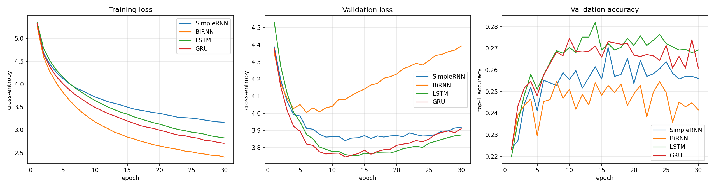
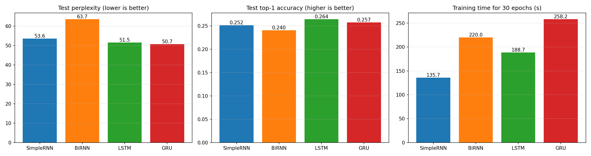
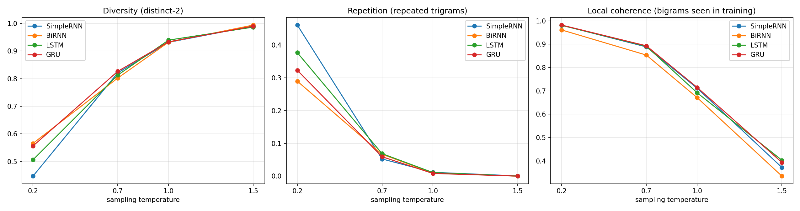

# Autoregressive Text Generation with Simple RNN, Bidirectional RNN, LSTM and GRU

Foundations of Generative AI (ICT4403), Assignment 2

Dishank Shah, Reg. No. 230953490

## 1. Problem statement and objective

Build a word-level autoregressive text-generation system: given the previous words of a text, predict the next word, append it, and repeat to generate text from a seed sequence.

Four recurrent architectures are implemented and trained under the same experimental conditions:

1. Simple (Elman) RNN
2. Bidirectional RNN
3. LSTM
4. GRU

The objectives are to

- compare the models quantitatively (loss, perplexity, next-word accuracy, training time),
- compare the text they generate qualitatively (coherence, diversity, contextual consistency, repetition),
- study how the sampling temperature changes the generated text, and
- decide which model gives the most effective autoregressive generation on this dataset.

## 2. Dataset

**Alice's Adventures in Wonderland** by Lewis Carroll, Project Gutenberg eBook #11 (public domain).

- Source page: <https://www.gutenberg.org/ebooks/11>
- Plain-text file used: <https://www.gutenberg.org/cache/epub/11/pg11.txt> (saved as [`data/alice_in_wonderland.txt`](data/alice_in_wonderland.txt))

### Characteristics

The book is a single continuous piece of English narrative prose with a lot of dialogue, a small cast of recurring characters and a fairly small vocabulary, which makes it a manageable corpus for training word-level models on a CPU. Statistics after cleaning (full list in [`results/dataset_stats.json`](results/dataset_stats.json)):

| Property | Value |
|---|---|
| Characters (book body only) | 144,008 |
| Tokens (words + punctuation) | 33,784 |
| Word tokens / punctuation tokens | 26,685 / 7,099 |
| Unique tokens | 2,637 |
| Tokens that occur only once | 1,139 |
| Sentences (approx.) | 1,640 |
| Average sentence length | 16.3 words |
| Most frequent words | the, and, to, a, she, it, of, said, i, alice |

The word distribution is heavily skewed: 43% of the unique tokens occur exactly once, while a handful of function words and punctuation marks make up most of the text. This is why next-word accuracy stays modest for every model.

### Preprocessing

Implemented in [`src/data.py`](src/data.py):

1. **Cleaning.** The Project Gutenberg header, table of contents and licence are removed; only the text from `CHAPTER I.` to `THE END` is kept.
2. **Normalisation.** Text is lower-cased, curly quotes are converted to straight quotes, em dashes become a `--` token and italics markers (`_`) are dropped.
3. **Tokenisation.** Word-level tokens. Contractions stay together (`don't`), and punctuation marks (`. , ! ? ; : ( ) " --`) are kept as separate tokens so the models can learn sentence and dialogue structure.
4. **Split.** The token stream is split contiguously into train / validation / test = 80% / 10% / 10% (27,027 / 3,378 / 3,379 tokens). Splitting before building windows means no validation or test sequence overlaps a training sequence.
5. **Vocabulary.** Built from the training split only. Words seen fewer than 2 times are mapped to `<unk>`, giving a vocabulary of 1,307 tokens. `<unk>` covers 3.8% of the training tokens, 9.1% of validation and 10.1% of test.

### Input-target sequences

A sliding window of 21 tokens is moved over each split one token at a time. The first 20 tokens are the input and the 21st is the target:

```
input : chapter i . down the rabbit hole alice was beginning to get very tired of sitting by her sister on
target: the
```

This gives 27,007 training, 3,358 validation and 3,359 test sequences.

## 3. Models

All four models share one definition ([`src/models.py`](src/models.py)) and differ only in the recurrent layer:

```
Embedding(1307, 100) -> Dropout(0.3) -> recurrent layer (128 hidden units) -> Dropout(0.3) -> Linear(vocabulary)
```

| Model | Recurrent layer | Trainable parameters |
|---|---|---|
| SimpleRNN | `nn.RNN` (tanh), one direction | 328,743 |
| BiRNN | `nn.RNN` (tanh), bidirectional, 128 units per direction | 525,479 |
| LSTM | `nn.LSTM` | 417,063 |
| GRU | `nn.GRU` | 387,623 |

- **Simple RNN** keeps a single hidden state that is overwritten at every step, so it struggles to carry information across many words.
- **Bidirectional RNN** runs one simple RNN left-to-right and another right-to-left over the 20-word context and concatenates their final states. Because the target word lies *outside* the input window, the backward pass never sees the word being predicted, so the model is still a valid autoregressive predictor.
- **LSTM** adds a cell state controlled by input, forget and output gates, which lets it retain information over longer spans.
- **GRU** uses two gates (update and reset) and no separate cell state. It has fewer parameters than the LSTM with similar capacity for longer-range context.

### Comparable experimental conditions

Every model uses exactly the same settings ([`src/config.py`](src/config.py)):

| Setting | Value |
|---|---|
| Data, vocabulary, sequence length | identical (20-word context) |
| Embedding size / hidden units | 100 / 128 |
| Dropout | 0.3 |
| Loss | cross-entropy |
| Optimiser | Adam, learning rate 0.001 |
| Batch size / epochs | 64 / 30 |
| Gradient clipping | max norm 5.0 |
| Random seed | 42 (same initialisation seed and same batch order) |
| Model selection | checkpoint with the lowest validation loss |
| Hardware | Intel Core i7-1165G7 (4 cores), CPU only, PyTorch 2.12.1 |

## 4. How to run

Requirements: Python 3.9+ with the packages in [`requirements.txt`](requirements.txt).

```bash
git clone https://github.com/Dishank13/autoregressive-text-generation-rnn.git
cd autoregressive-text-generation-rnn
pip install -r requirements.txt

# 1. Train all four models and evaluate them on the test split (about 13 minutes on a laptop CPU)
python -m src.train

# 2. Generate text at every temperature and compute the text metrics (under a minute)
python -m src.generate
```

The dataset is already in `data/`, and the trained weights are in `results/checkpoints/`, so step 2 can be run without retraining.

### Repository layout

```
├── data/
│   └── alice_in_wonderland.txt     dataset (Project Gutenberg #11)
├── src/
│   ├── config.py                   all hyperparameters
│   ├── data.py                     cleaning, tokenisation, vocabulary, input-target sequences
│   ├── models.py                   the four models
│   ├── train.py                    training, evaluation, comparison plots
│   └── generate.py                 temperature sampling, text metrics, sample file
├── results/
│   ├── dataset_stats.json          dataset statistics
│   ├── training_log.txt            per-epoch log of the reported run
│   ├── training_history.json       per-epoch losses, accuracy and timings
│   ├── metrics.csv                 final metrics for each model
│   ├── training_curves.png         loss and accuracy curves
│   ├── model_comparison.png        test perplexity, accuracy and training time
│   ├── temperature_metrics.csv     text metrics per model and temperature
│   ├── temperature_analysis.png    effect of temperature
│   ├── generated_samples.md        generated text for every model, seed and temperature
│   └── checkpoints/                trained weights (best validation epoch)
├── requirements.txt
└── README.md
```

## 5. Results

All numbers below come from the run recorded in [`results/training_log.txt`](results/training_log.txt) and [`results/metrics.csv`](results/metrics.csv). Test metrics are computed on the 3,359 held-out test sequences using the checkpoint with the lowest validation loss.

| Model | Best epoch | Val. perplexity | Test loss | Test perplexity | Test accuracy (top-1) | Test accuracy (top-5) | Training time, 30 epochs | Time per epoch |
|---|---|---|---|---|---|---|---|---|
| SimpleRNN | 12 | 46.55 | 3.981 | 53.60 | 25.16% | 48.56% | 135.7 s | 4.5 s |
| BiRNN | 6 | 54.85 | 4.153 | 63.65 | 24.03% | 46.53% | 220.0 s | 7.3 s |
| LSTM | 14 | 42.65 | 3.942 | 51.53 | **26.44%** | **49.45%** | 188.7 s | 6.3 s |
| GRU | 12 | **42.30** | **3.926** | **50.72** | 25.72% | 49.36% | 258.2 s | 8.6 s |

Perplexity is `exp(cross-entropy loss)`. Because rare words are merged into `<unk>` and punctuation marks are tokens, these perplexities are only comparable between the four models here, not with results that use a different vocabulary.





## 6. Model comparison and evaluation

### Quantitative

- **Loss and perplexity.** The two gated models are best: GRU (test perplexity 50.72) and LSTM (51.53), followed by the Simple RNN (53.60). The Bidirectional RNN is clearly worst (63.65).
- **Prediction accuracy.** LSTM has the highest top-1 accuracy (26.44%), GRU is second (25.72%), then Simple RNN (25.16%) and BiRNN (24.03%). Top-5 accuracy is close to 49% for LSTM and GRU.
- **GRU vs LSTM.** The gap between them is small (0.8 perplexity points, 0.7 accuracy points, in opposite directions) and comes from a single training run, so on these numbers alone they should be treated as roughly equal.
- **Overfitting.** Training loss keeps falling for all models while validation loss turns upward, which is expected on a 27k-token training set. The BiRNN overfits fastest: its best validation loss is at epoch 6, and by epoch 30 its training loss is 2.41 against a validation loss of 4.39. The Simple RNN and LSTM degrade the least after their best epoch (validation loss rises by 0.08 and 0.12 by epoch 30), the GRU by 0.17 and the BiRNN by 0.39.
- **Training time.** The Simple RNN is the cheapest (4.5 s per epoch). BiRNN costs about 1.6 times as much because it runs two recurrent passes. In this run the GRU was slower per epoch than the LSTM (8.6 s vs 6.3 s) even though it has fewer parameters. These are single wall-clock measurements on a laptop CPU, so the ordering of the two gated models should not be read as a general property of the architectures.

A likely reason for the weak BiRNN result is that the backward RNN finishes on the *oldest* word of the window, so its final state mainly summarises the part of the context that is furthest from the word being predicted. It adds 60% more parameters than the Simple RNN without adding much useful information for next-word prediction, which shows up as faster overfitting.

### Qualitative

Full samples are in [`results/generated_samples.md`](results/generated_samples.md). Seeds are three 20-word passages from the unseen test split. The observations below refer to temperature 0.7 unless stated otherwise.

| Aspect | SimpleRNN | BiRNN | LSTM | GRU |
|---|---|---|---|---|
| Coherence | Correct short phrases, but clauses often break mid-way (`the queen of at the distance`). | Weakest. Frequent ungrammatical fragments (`the moral of the kitchen of the way of a little good tree`, `i wish i wish i don't know`). | Good phrase-level grammar and well-formed dialogue (`"the reason is, " said the queen`). | Longest well-formed stretches (`the queen was speaking to bring it as much as she could`). |
| Diversity | High | Slightly lowest | High | Highest distinct-2 |
| Contextual consistency | Continues the seed grammatically for a few words, then drifts to frequent characters. | Same, and loses the thread soonest. | Produces several dialogue turns in a row with speaker tags. | Similar to LSTM; stays in narration or dialogue mode for longer. |
| Repetition | Worst at low temperature (loops on `, and the queen, and the queen of the house`). | Lowest measured repetition at low temperature, but at the cost of grammar. | Loops on longer phrases (`the little golden key was sitting on the door`). | Loops on dialogue (`"i don't know what you mean, " said the hatter`), less often than LSTM. |

Common to all four models:

- Every model picks up the surface style of the book: frequent `said alice`, dialogue in quotation marks, and recurring characters such as the queen, the hatter and the gryphon.
- The first few generated words fit the seed grammatically. For example, the seed ending `your majesty must` is continued with `be a ...` by every model at T = 0.2.
- None of the models keeps the *topic* of the seed (the trial scene) for more than a few words. Long-range consistency is beyond what these small models learn from this amount of text.

## 7. Sampling-temperature analysis

At each step the logits are divided by the temperature `T` before the softmax. `T < 1` sharpens the distribution towards the most likely words; `T > 1` flattens it.

Four temperatures were used (0.2, 0.7, 1.0, 1.5) with the same three seeds. For each model and temperature, 15 samples of 100 words were generated (3 seeds x 5 samples) and averaged. For a given seed and temperature, every model is sampled with the same random stream.

Automatic measures ([`results/temperature_metrics.csv`](results/temperature_metrics.csv)):

- **distinct-2**: unique bigrams / total bigrams in a sample (diversity).
- **repetition**: share of trigrams that already appeared earlier in the same sample.
- **seen bigrams**: share of generated bigrams that also occur in the training text. This is used as a rough proxy for local coherence. It rewards familiar word pairs, so it also rewards copying, and it should be read together with the samples.

| Model | T | distinct-1 | distinct-2 | repetition | seen bigrams |
|---|---|---|---|---|---|
| SimpleRNN | 0.2 | 0.301 | 0.447 | 0.461 | 0.981 |
| SimpleRNN | 0.7 | 0.516 | 0.821 | 0.052 | 0.888 |
| SimpleRNN | 1.0 | 0.634 | 0.931 | 0.012 | 0.711 |
| SimpleRNN | 1.5 | 0.789 | 0.991 | 0.001 | 0.372 |
| BiRNN | 0.2 | 0.359 | 0.566 | 0.290 | 0.961 |
| BiRNN | 0.7 | 0.492 | 0.802 | 0.067 | 0.853 |
| BiRNN | 1.0 | 0.630 | 0.932 | 0.010 | 0.671 |
| BiRNN | 1.5 | 0.793 | 0.994 | 0.000 | 0.335 |
| LSTM | 0.2 | 0.340 | 0.506 | 0.377 | 0.981 |
| LSTM | 0.7 | 0.537 | 0.813 | 0.069 | 0.891 |
| LSTM | 1.0 | 0.641 | 0.939 | 0.011 | 0.692 |
| LSTM | 1.5 | 0.759 | 0.987 | 0.000 | 0.403 |
| GRU | 0.2 | 0.373 | 0.556 | 0.323 | 0.982 |
| GRU | 0.7 | 0.533 | 0.826 | 0.059 | 0.893 |
| GRU | 1.0 | 0.645 | 0.933 | 0.008 | 0.715 |
| GRU | 1.5 | 0.777 | 0.990 | 0.000 | 0.393 |



### Effect of temperature

- **T = 0.2 (near-greedy).** Locally fluent but highly repetitive. 29% to 46% of trigrams are repeats, and the models fall into loops such as `and the queen, and the queen of the house` (SimpleRNN) or `"i don't know what you mean, " said the hatter` (GRU). Diversity is low (distinct-2 between 0.45 and 0.57). Almost every bigram (96% to 98%) is one seen in training.
- **T = 0.7.** The best trade-off for every model. Repetition falls to 5% to 7%, distinct-2 rises to about 0.8, and 85% to 89% of bigrams are still ones seen in training. Sentences have recognisable structure, with dialogue, speaker tags and narration.
- **T = 1.0.** Sampling from the unmodified distribution. Repetition almost disappears (about 1%) and diversity is high, but grammar starts to break (`she forgetting changed about that anxious to do`). Only 67% to 71% of bigrams are seen in training.
- **T = 1.5.** Close to random word sequences. distinct-2 is about 0.99 and repetition is zero, but fewer than 41% of bigrams are seen in training and the text is not readable (`something her out and soup carefully at the distance she; however.`).

So raising the temperature trades coherence for diversity and removes repetition, and lowering it does the opposite. This pattern is the same for all four architectures; temperature has a much larger effect on the generated text than the choice of model.

Model differences are most visible at the two extremes. At T = 0.2 the Simple RNN repeats the most (0.46), since its short memory makes it fall back on the same high-frequency phrase, while GRU and BiRNN repeat the least. At T = 1.5 the gated models hold on to slightly more valid word pairs (LSTM 0.40, GRU 0.39) than the Simple RNN (0.37) and BiRNN (0.33).

One note on reading the samples: at T = 1.0 and 1.5 different models sometimes produce the same words at the same positions. This is a side effect of giving every model the same random stream, not a sign that the models are copying each other.

## 8. Conclusion

**The GRU is the most effective autoregressive generator for this dataset**, with the LSTM a close second.

- It has the lowest validation and test perplexity (42.30 and 50.72), which is the most direct measure of how well a model predicts the next word.
- At the most useful temperature (0.7) it gives the best balance of the four models: the highest bigram diversity (0.826), the highest share of valid word pairs (0.893) and lower repetition than the LSTM (0.059 vs 0.069).
- At low temperature it repeats less than the LSTM and far less than the Simple RNN, without the grammatical errors of the BiRNN.
- Its samples contain the longest well-formed clauses and keep dialogue structure.

The LSTM is essentially tied on perplexity, has the best top-1 accuracy (26.44%) and was faster to train in this run, so it is a reasonable alternative. The Simple RNN is the fastest to train and only about 3 perplexity points behind, but it is the most repetitive. The Bidirectional RNN is the least suitable: it is the largest model, overfits within 6 epochs, has the worst perplexity and accuracy, and produces the least grammatical text. Bidirectional context helps when the whole sequence is available, but for next-word generation only the left context exists, so the second direction adds cost without benefit.

### Limitations

- Results come from one training run per model with one random seed. The GRU and LSTM are too close to separate reliably without repeated runs.
- The corpus is small (about 27k training tokens), so all models overfit and none maintains the topic of the seed.
- 10% of test tokens are `<unk>`, which makes the reported perplexity and accuracy specific to this vocabulary.
- Training times are single wall-clock measurements on a laptop CPU.
- Coherence is judged by reading the samples and by a bigram-overlap proxy, not by human rating.
